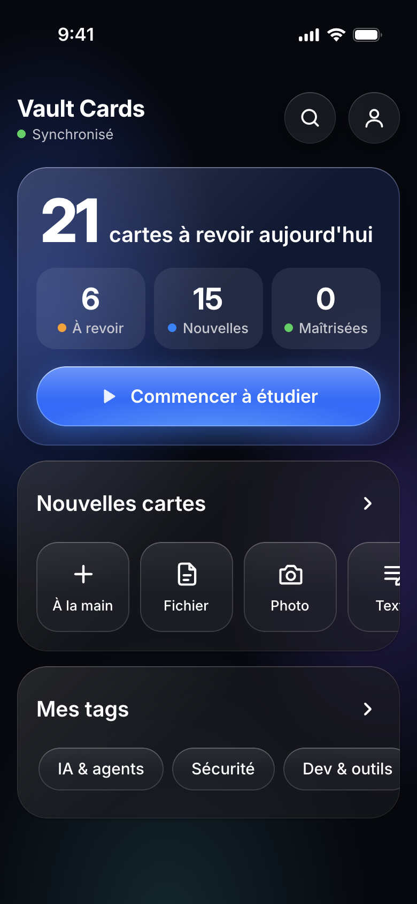
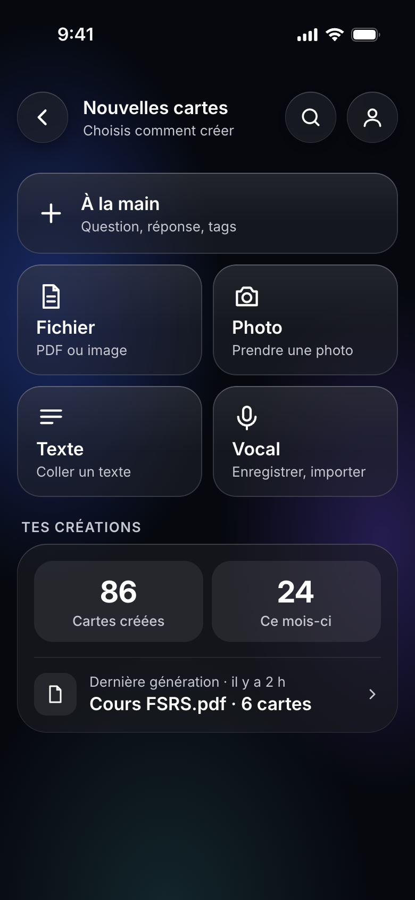
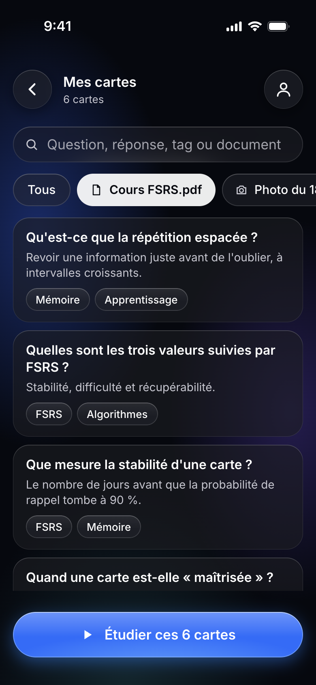

# Vault Cards

> 🚧 **Projet en construction.** Vault Cards sert d'abord à un usage personnel. L'installation n'est pas encore simplifiée et peut demander des ajustements.

Application de flashcards à répétition espacée (FSRS), pensée pour l'iPhone. Elle fonctionne hors ligne et se synchronise avec Supabase. Les cartes viennent de notes Obsidian, de documents, de textes, de photos ou de vocaux, et peuvent aussi s'écrire à la main.

<p align="center">
  
  
  
  
</p>

<p align="center"><sub>Maquettes de l'application, avec des données fictives.</sub></p>

## Fonctionnalités

- **Révision FSRS** : file du jour, révision libre, étude par tag ou par liste filtrée.
- **Hors ligne** : PWA installable, cache local, synchronisation au retour du réseau.
- **Création de cartes** : à la main, ou depuis un fichier, une photo, un texte ou un vocal.
- **Relecture avant ajout** : les cartes générées depuis la boîte de réception arrivent en brouillon, à valider dans l'app.
- **Gestion** : recherche, tags libres, modification et suppression.
- **Notes Obsidian** : l'outil `tools/cards` et le skill Claude Code `/flashcards` transforment des synthèses en cartes.

L'interface est en français.

## Stack

React 19, TypeScript, Vite, Konsta UI, Tailwind CSS 4, Dexie (IndexedDB), ts-fsrs, Supabase (Postgres, Auth, Storage).

## Démarrer

Ces étapes donnent le principe, mais elles n'ont pas encore été testées sur une installation neuve.

Il faut Node 24 et un projet [Supabase](https://supabase.com) avec son [CLI](https://supabase.com/docs/guides/cli).

```bash
git clone https://github.com/kylliandelbauche/vault-cards.git
cd vault-cards
npm install
cp .env.example .env.local
```

Renseigne `VITE_SUPABASE_URL` et `VITE_SUPABASE_PUBLISHABLE_KEY` dans `.env.local`, puis applique le schéma et lance l'app :

```bash
supabase link --project-ref <ton-projet>
supabase db push
npm run dev
```

Les inscriptions sont désactivées : crée ton compte dans le tableau de bord Supabase (Authentication > Users).

La clé secrète Supabase (`SUPABASE_SECRET_KEY`) sert uniquement à `tools/cards`, en local. Elle ne doit jamais se retrouver côté client ni dans le dépôt.

## Vérifications

```bash
npm run lint && npm run typecheck && npm test && npm run build
```

## Documentation

- [Spécification](docs/specs/2026-10-12-vault-cards-design.md)
- [Audit de sécurité](docs/security-checklist.md)
- [Restauration d'une sauvegarde](docs/restore.md)
- [Skill `/flashcards`](skill/flashcards/SKILL.md)

## Licence

[MIT](LICENSE)
